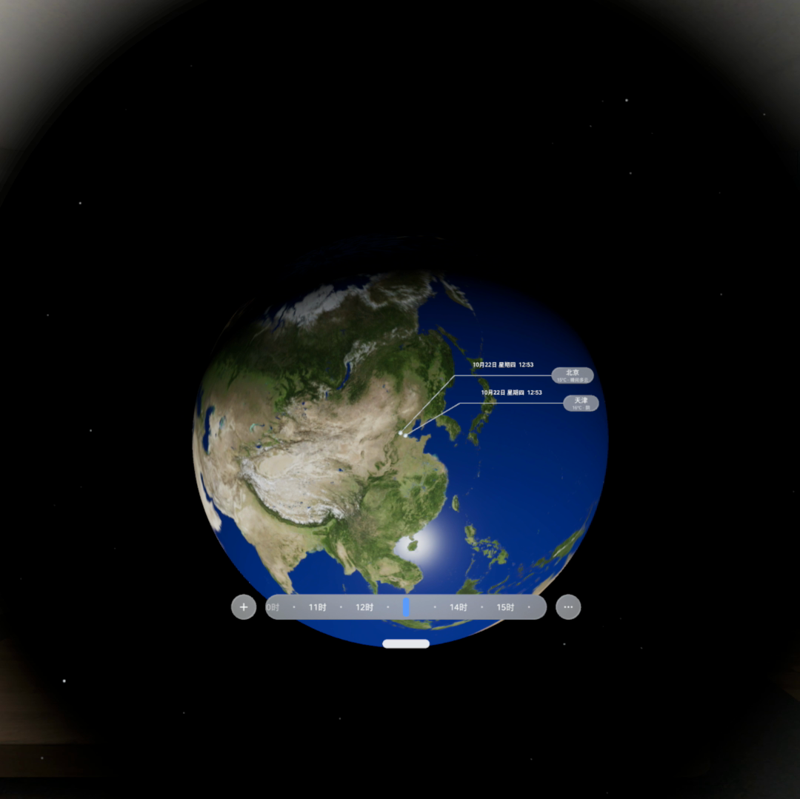

# 世界时钟 · World Clock for PICO

基于 **PICO Spatial SDK 6.1.9、Kotlin 和 Compose** 的 MR 地球、世界时间与全球气温应用。当前用户确认版本为 **V63 / 0.63.0**，2026-10-23 已获头显体验认可并授权上传 GitHub；V57 保留为此前稳定回退版本。使用用户提供的 AI 8K 颜色图与高光图。`v0.52.0` 保留加入气温模块前的版本，`release/v0.57.0` 保留此前稳定版本。本工程不是 Unity 项目。

## V72 连续经纬线，仅在 Full 显示

普通经纬线恢复连续实线，保留青色赤道、金色本初子午线及现有刻度/文字。Shared 不创建经纬图层、坐标卡或选点处理，也不显示经纬入口；Full 的开关状态保留到再次展开。130 项检查和全部 72 项原资产字节校验通过，已安装模拟器，等待用户手动往返验证。见 [V72 交接](HANDOFF_V72.md)。

## V71 长线段、短断口与地理核对（历史）

普通网格保持稀疏分段，改为长线段与短断口（.140 / .040），沿球面弯曲。使用独立海岸线核对当前贴图，未发现经纬轴整体错位或方向颠倒；修正 ±75° 小刻度受到极区平滑影响的约 0.1° 偏差。131 项检查、全部 72 项原资产字节校验通过，已安装模拟器；已截图核对欧洲/非洲、美洲可见区域，菜单遮挡部分未作完整视觉结论，真机待验收。见 [V71 交接与验证边界](HANDOFF_V71.md) 和 [地理对照图](docs/images/coordinate-geography-v71.png)。

## V70 稀疏虚线与文字防倒置（历史）

普通网格短划数量降至约三分之一。修正有方向切线导致文字多圈旋转后倒置的问题：保持固定地理锚点，只调整有界 Z 倾斜；接近竖直和侧视时平滑放平，不再跨界翻转。新增文字上方向检查。129 项检查和全部 72 项原资产校验通过，已安装模拟器，等待用户手动视觉反馈。见 [V70 交接与验证边界](HANDOFF_V70.md)。

## V69 文字固定地理位置（历史）

度数及两条主线名称直接绑定地球旋转层级，局部位置固定；移除前方阅读面、自动避让和文字引线，字面仅随刻度方向调整 Z 轴角。保留短划网格、彩色实线和现有字体大小。125 项检查、全部 72 项原资产校验通过，已装到模拟器，等待用户手动验证动画跟随；未连接头显。详见 [V69 交接](HANDOFF_V69.md)。

## V68 短划网格与持续可见刻度（历史）

普通网格改为短划线，赤道青色和本初子午线金色实线保留。经度尺归到赤道，纬度尺沿本初子午线向南北延伸；全部数字和名称使用独立竖直阅读面，跟随地理锚点移动，拥挤时错开，转到背面也不隐藏。字号增至 22 sp。124 项检查及全部 72 项原资源字节校验通过，最终 r2 已装到模拟器，等待用户手动视觉反馈；未连接头显。详见 [V68 交接与验证边界](HANDOFF_V68.md)。

## V67 地理绑定刻度与彩色主线（历史）

外侧刻度、引线和文字锚点改为跟随地球自转、拨动与回正，赤道青线、本初子午线金线。121 项单元检查、72 项原资产校验通过；用户随后截图反馈文字缺失/侧立、标尺错位，V68 已针对这些问题修改。V67 的背面淡出规则已被用户“文字始终显示”要求覆盖。见 [V67 历史说明](docs/coordinate-rulers-v67.md) 与 [交接](HANDOFF_V67.md)。

## V66 经纬双刻度尺

按用户确认，外侧改为左侧纬度尺、下侧经度尺，位置面向用户稳定，读数从所指向的真实地表位置更新；文字放大、入口改为“经纬”，平滑日期变更线的辅助网格接缝。119 项单元检查与 72 项原资产字节校验通过，已安装模拟器，手动画面反馈待确认。见 [V66 说明](docs/coordinate-rulers-v66.md) 与 [交接](HANDOFF_V66.md)。

## V65 经纬线与文字修正

按 V64 体验反馈，网格略微浮起，线条改为加粗圆截面，极区平滑汇聚到原模型极点；参考文字直接随三维地理锚点移动，放大字号。用户已确认此前拖动不误选且仅出现一张主要坐标卡。115 项单元检查与原资源校验通过，V65 已装到模拟器，连续画面和真机表现待用户手动验证。见 [V65 说明](docs/coordinate-locator-v65.md) 与 [交接](HANDOFF_V65.md)。

## V64 经纬定位开发版

在原工具菜单统一开启经纬定位：30° 细白网格、赤道与本初子午线、地理纬度刻度、短按选点与坐标卡。以原模型 UV 离线计算坐标，复用城市卡与地球交互，原资源保持。113 项单元检查及 72 项 V63 原资产校验通过，已构建并安装到模拟器，等待用户手动画面验证；V63 仍是用户认可的稳定版。见 [V64 说明](docs/coordinate-locator-v64.md) 与 [交接](HANDOFF_V64.md)。

## V63 桌面尺寸与自转

按头显体验反馈，Shared 默认直径改为 0.5 米，滑条范围 0.18–0.8 米，自转为 9°/秒（40 秒一圈）。容器和控件空间同步扩大；白色底板关闭更新改为 Shared 就绪后执行、最多三次重试。Full 保持 3°/秒及原资源。104 项单元检查和 APK 资源校验通过，用户确认“这版挺好，先这样”，本轮按此版本收尾。该反馈为整体佩戴体验认可，不替代未新增的功耗测量或逐项日志验证。见 [V63 说明](docs/shared-desktop-v63.md) 与 [交接](HANDOFF_V63.md)。

## V62 桌面地球视觉调整

Shared 新增平滑晨昏过渡和局部夜灯闪烁，自转调为 4.5°/秒，关闭系统白色底板；保留 V61 海面高光、2K 云层、尺寸滑条与圆形展开入口。Full 仍为 3°/秒，原画质资源不变。103 项单元检查、编译材质及 APK 资源校验通过，已安装到头显，等待用户手动视觉验收。见 [V62 说明](docs/shared-desktop-v62.md) 与 [交接](HANDOFF_V62.md)。

## V58 共享空间桌面地球

菜单新增“收起到桌面”，实际关闭 Stage 后在 Shared Space 的立体容器中显示 25 cm 地球；支持 18–35 cm 调节及“展开”返回。桌面使用独立 3K 昼图/2K 夜灯，缓慢展示自转与真实时间分离，切换释放上一种场景资源。

101 项单元测试、模拟器双向切换/失败恢复/气温状态/共用时间尺及关闭测试通过。整个容器手动摆放、共享多应用输入体验、真机位置稳定和 GPU 内存下降尚未验收。详见 [V58 实现、操作与验证边界](docs/shared-desktop-v58.md)。

## V57 共用时间滑条与全球气温

- 时间尺右侧圆形温度计切换气温模式，两种模式共用原有六小时时间尺，各自保存时间状态。
- 独立气温球壳与上方对齐的色阶条同步渐显、渐隐；沿用 PICO 官方材质、主题、字体与 hover。
- 真实 NOAA GFS 全球 2 m 空气温度网格、固定色阶、同源城市读数；默认气温叠加强度 100%，0°C 为深蓝，25°C 以上以 3°C 分档。
- 原高清地球资产保持独立；气温原始网格、小时预报和数据处理脚本一并保存。

2026-10-22 用户反馈模拟器体验正常，并确认本版稳定、授权上传。构建及 98 项单元测试通过；自动集成用例第一次因测试线程错误中断，修正源码已保存，尚无重跑通过记录。用户手动体验与自动验收分别记录，未据此宣称真机性能或视觉已验收。线上数据服务尚待部署，当前样例保留真实数据时间和过期状态。

详见 [V57 实现与验收](docs/global-temperature-v57.md)、[Figma 设计参数](docs/designs/shared-timeline/README.md) 和 [数据处理与部署](temperature_pipeline/README.md)。

## V52 高光图试验

V52 / 0.52.0：用户提供原始8192×4096高光遮罩，SHA256 171e20f9c6df227fc960acca2ca82043daaa18de12a9de7b320c4291b2e2cd35。只将运行时 SpecularTex_file 改绑到 earth_data/specular_ai_v52_8k.png，保留 RAW + LINEAR；V51 Earth.bundle 完全不变，16项既有APK资源均保持字节一致，原高光图仍保留。颜色继续用V51的AI原图；海洋/陆地粗糙度.30/.78、IOR1.333/1.45及其他参数不变。编辑器候选源为EarthSwanV52，运行时仍加载既有EarthSwanV51后覆盖高光纹理。

APK 构建与资源一致性检查通过；已在 SWAN 覆盖安装并启动 0.52.0，设备日志确认 RAW + LINEAR 高光绑定、反射参数和开场完成，捕获日志无致命异常。佩戴观感仍以实际体验为准；本次没有重复运行未变更逻辑的单元测试。`v0.51.0` 为本次直接回退版本。编辑器重新导出不是这次运行时替换的必要步骤。

## 当前功能

- 原始 8192×4096 昼间、夜灯、法线及高光资源，海陆分别控制反射。
- 根据真实 UTC / 预览时间计算太阳位置和晨昏线；23.44° 地轴。
- 前方黑色虚拟区域与周围 VST 的渐变衔接，配合地球开场入画。
- 捏合拨动、待机自转、城市聚焦、柔和回正，以及静态云层的交互淡入淡出。
- 离线城市 / 国家目录、最多 8 个地点、当地日期时间和当前天气。
- 六小时时间尺、日期滚轮、现在标记、可移动工具栏。
- V50：相邻城市详情上下避让，保留每个可见地点，保持右侧引线和稳定排布。

## 工程结构

| 路径 | 内容 |
| --- | --- |
| `WorldClockSpatial/` | 可直接在 Android Studio 打开的运行时工程与测试 |
| `WorldClockSpatial/app/src/main/assets/` | 已编译资源，构建 APK 时无需重新导出模型 |
| `WorldClockEditor/` | 当前地球、云层和太阳的 Spatial Editor 场景及源资源 |
| `WorldClockEditor/Sources/Textures/` | 完整原始 8K 贴图 |
| `docs/` | 版本说明、资源校验清单及模拟器效果图 |
| `temperature_pipeline/` | GFS 数据获取、校验、数值网格转换及部署示例 |
| `tools/` | 材质生成、本机构建与模拟器验证入口 |

收录当前运行时资源、对应编辑器源文件和保留的 V49 / V51 / V52 地球版本。更早版本的中间导出、缓存、机器配置、签名密钥和旧 APK 不在仓库内。

## 构建与运行

1. 安装 Android Studio、JDK 17 或兼容的 Android Studio JBR，以及 Android SDK 35。
2. 用 Android Studio 打开 `WorldClockSpatial`，让 IDE 配置本机 SDK 路径并同步 Gradle。
3. Gradle 会从工程已配置的仓库获取依赖，包括 PICO 的 Maven 仓库。Gradle Wrapper 版本为 8.13。
4. 在 `WorldClockSpatial` 目录执行：

```powershell
.\gradlew.bat testDebugUnitTest assembleDebug
```

macOS / Linux 可以使用 `./gradlew testDebugUnitTest assembleDebug`。若使用命令行，需要正确设置 `JAVA_HOME` 和 Android SDK 路径；不要把个人 `local.properties` 提交到 Git。

APK 输出到 `WorldClockSpatial/app/build/outputs/apk/debug/app-debug.apk`。连接并授权 USB 调试后：

```powershell
adb devices
adb -s <设备序列号> install -r app/build/outputs/apk/debug/app-debug.apk
adb -s <设备序列号> shell am start -n com.wupengfei.worldclock/.platform.LaunchActivity
```

目标环境为 PICO SWAN、OS 6.0+；实际兼容性应在目标系统和对应 SDK 上验证。最终空间使用 `StageStyle.Mixed`。

## 编辑三维资源

使用本机 PICO Spatial Editor 打开 `WorldClockEditor/WorldClockEarth.spatialproject`。当前资源对应关系：

| 运行时资源 | 编辑器场景 |
| --- | --- |
| `Earth.bundle` | `Sources/Scenes/EarthSwanV51.usda` |
| `Clouds.bundle` | `Sources/Scenes/CloudsV41.usda` |
| `SunEffects.bundle` | `Sources/Scenes/SunEffectsV36.usda` |
| `Temperature.bundle` | `Sources/Scenes/TemperatureV56.usda` |

源 USD 的贴图引用已改为相对路径；V51 仅更换昼间颜色图，其余三个地表纹理的编译数据与 V50 完全一致。重导出时保留原始 8K 图，不启用自动降采样。太阳和云层还有运行时参数，详见 `HomeStage.kt` 与 `ClockScene.kt`。

## V51 试验说明

V51 / 0.51.0 是用户 AI 昼间颜色图试验版：使用本机原始 8192×4096 PNG，SHA256 e034b66dfefab2171d49ecbf8ac68606e0902397203447eea56b60ec6a2932eb。只替换 Day 图；模型网格、法线、夜灯、高光、云层及交互保持。原 day_8k.jpg 与 V50 版本保留，未采用会话中的 2K 附件副本。

V51 构建成功，已在模拟器验证资源加载、开场和画面，并曾在 SWAN 安装启动；随后头显已更新到 V52。下方 84 项单元测试及真机状态是 V50 基线记录，本次没有重复运行未变更逻辑的测试。

## V50 基线验证状态

- V50：84 项单元测试通过。
- 模拟器检查北京 / 天津双城、切换城市、8 个邻近地点同时显示，未出现标签面板相互覆盖。
- SWAN 设备已安装启动 0.50.0，启动日志确认入画完成；真机佩戴观感需实际体验。
- 模拟器录屏与动画回调频率不代表头显 GPU 帧率。



## 数据与授权

城市和时区数据的来源与许可证保存在 `app/src/main/assets/cities/`。天气使用 Open-Meteo，保留应用内来源标注；当前免费服务配置面向非商业使用，商业发布前需确认服务条款或替换服务。

这是私人项目源码备份，不授予代码或美术资源的公开分发许可。第三方数据继续遵守各自许可证。仓库不包含个人签名密钥或任何账户凭据。


## 全球气温数据与历史实现

V53 至 V57 的气温开发记录随当前版本保留，包含真实 NOAA GFS 2 m 全球气温、模式切换、逐小时预报、固定色阶及同源城市查询。原 V52 标签保留。

- [操作与实现说明](docs/global-temperature-v53.md)
- [本地处理与部署](temperature_pipeline/README.md)
- [验证记录](docs/validation/)

线上数据服务和真机验收仍待完成；内置样例会标注实际有效时刻与过期状态。
