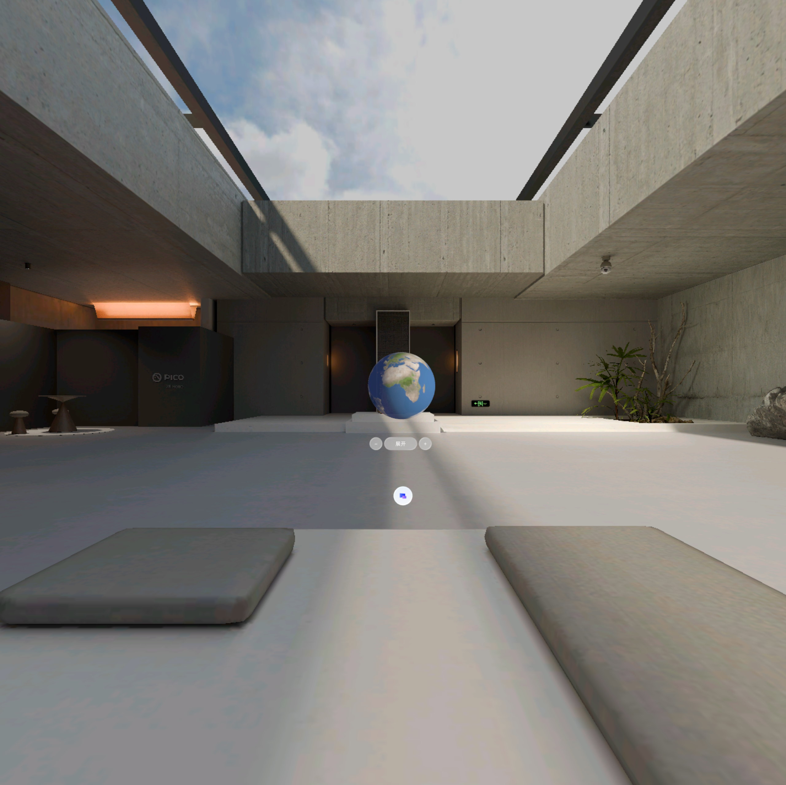
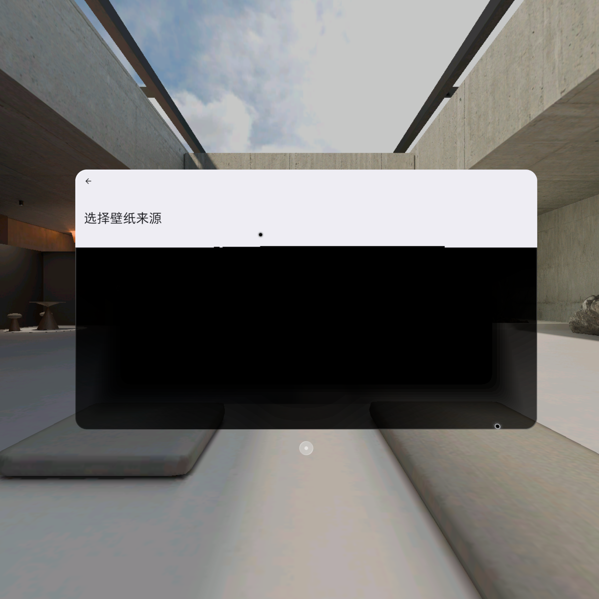

# V58 共享空间桌面地球

版本：0.58.0 / 58。基线：用户确认稳定的 V57，提交 `e66e668`。
本版是可安装的模拟器验证版；尚未完成真机摆放和 GPU 内存验收。

## 使用

1. 正常进入原有沉浸地球，打开右侧菜单，选择 **收起到桌面**。
2. 完整地球收缩淡出，Stage 关闭，Shared Space 中显示桌面地球。
3. 使用容器的系统底座/窗口摆放控件移动整个容器。应用没有用“移动容器内部模型”冒充空间摆放；实际拖放体验仍待验证。
4. `−` / `+` 调整直径，默认 25 cm，暂定范围 18–35 cm；点击 **展开** 返回完整场景。
5. 原有关闭按钮仍关闭软件。桌面窗口也保留系统关闭入口；切换失败时额外提供应用内关闭按钮。

桌面地球每 12 分钟展示旋转一周，持续逐帧更新。展示旋转与真实 UTC / 预览时间分离，不加速时间或太阳计算。世界时间预览、所选城市、展示朝向及气温所选小时保存在同一会话。桌面只显示日夜地表，气温色层留到展开后恢复。

## 实现和 SDK 核实

沿用 Kotlin / Compose、PICO Spatial SDK 6.1.9 和既有 Spatial Editor 工程。没有新建 Unity 工程或迁移云端。

- 原完整地球继续放在 `WorldClockEarthMixedV08` 的 Mixed Stage。
- 新增 `WorldClockDesktopV58` Volumetric WindowContainer，固定 tag `earth` 防止重复实例；容器物理尺寸 45 × 50 × 45 cm，采用官方默认 caption、底座和 Gravity 对齐。
- `SpatialView`、AssetBundle、ShaderGraphMaterial 和 SceneEvents.Update 已在该立体容器内运行。最大 35 cm 地球中心上移 2.5 cm，几何边界仍位于容器内；桌面取消云层、大气和透明气温球壳。
- 收起流程等待完整渲染器释放，再关闭 Stage；同时等待 Stage composition 销毁和 `getSelfSpaceState() == SHARED_SPACE`，随后加载轻量地球。
- 展开先释放桌面模型与 bundle，再 openStage；完整场景准备完毕后最小化桌面窗口并淡入。初版不尝试两个不同容器间的连续世界坐标动画。
- `WorldClockSession` 只持有 CPU 会话状态；两种渲染器各自持有、关闭资源，不使用 global 资源保活。
- 切换期间锁定重复操作；加载/打开失败有超时和回退；失败恢复也检查实际 Shared Space。恢复未完成时显示重试/关闭入口，不误报成功。
- 桌面逐帧更新不依赖 `isFocused`，按 `isSighted`（至少部分进入 FOV）更新；不使用会因部分遮挡而变 false 的 `isOnstage`，避免另一共享应用遮挡部分地球时冻结。系统上报不可见或停止帧回调时暂停展示更新，恢复时限制单帧时间步长，避免追赶跳转。另一应用 Full Space 的实际隐藏/恢复事件仍待设备验证。
- 关闭软件同时关闭窗口和 Stage，并移除本应用保留的 Activity task；收起期间保留 task。

官方参考：[WindowContainer](https://developer.picoxr.com/spatial-api/6.1.9/spatialui/foundation/com.pico.spatial.ui.foundation.dsl/-window-container.html)、[closeStage](https://developer.picoxr.com/spatial-api/6.1.9/spatialui/platform/com.pico.spatial.ui.platform.containers/close-stage.html)、[VolumeBasePanelType](https://developer.picoxr.com/spatial-api/6.1.9/spatialui/platform/com.pico.spatial.ui.platform.resize/-volume-base-panel-type/index.html)。SDK 源码检查与模拟器实测共同确认上述接口路径。

本版不使用锚点或平面检测，也不申请桌面识别；这些能力在官方文档中要求 Full Space：[空间锚点](https://developer.picoxr.com/document/spatial-sdk/spatial-anchor/)、[平面检测](https://developer.picoxr.com/document/spatial-sdk/plane-detection/)。系统是否保留同一物理位置未验证，不承诺跨重启锚定。

## 资源与内存

新增独立 `DesktopEarth.bundle`：

| 资源 | 包内实际尺寸 | 用途 |
| --- | --- | --- |
| desktop_day_3k.png | 3072 × 1536 | 昼间颜色及夜间极弱地形 |
| desktop_night_2k.png | 2048 × 1024 | 夜灯 |
| 地表 | 1 个不透明 Unlit ShaderGraph 材质 | UTC 太阳方向驱动日夜交界 |

已经检查最终 bundle 的纹理描述，避免编辑器默认 2048 限制把 3K 昼图再次缩小。两张纹理为 RGBA8、含 mip，理论纹理数据约 34.67 MiB；这是资源预算，不是 GPU 实测值。

完整模式的 8K 地表、法线、高光、云图、温度纹理和特效都不在桌面 bundle 中。切换时释放实体、显式纹理、临时材质、温度渲染器、bundle 和帧订阅；Stage 关闭也结束其容器资源所有权。桌面窗口会保留并最小化，因此另行显式关闭它独占的两张纹理、材质和网格，不等待窗口销毁。APK 仍包含完整模式所需原资源，只有重新展开才加载它们。V57 的 71 个既有 assets 全部 SHA-256 一致。

两次六轮最终 3K 采样（每次 GC 后等待 1 秒）：第一组桌面 PSS 约 353–414 MiB、完整模式约 429–612 MiB；第二组桌面约 397–576 MiB、完整模式约 473–721 MiB。PSS 包含系统缓存和共享映射，不能当作显存。第二组桌面 Native Heap 已分配约 52.8–53.4 MiB，实际堆分配相对稳定，但 Unknown/Private Other 波动较大，**尚不能据此判定无内存累积**。完整场景重新加载仍有内存峰值，长期稳定性与真实 GPU 内存需要继续验收。

随后加长到二十轮，发现保留桌面窗口时应明确关闭其材质、网格和两张纹理。加固前桌面首末 PSS 461.3 → 589.7 MiB；加固后二十轮为 431.5 → 460.5 MiB，范围 386.9–468.9 MiB；完整模式范围 464.4–547.0 MiB。桌面 Native Heap 已分配首末 53.4 → 58.8 MiB。总内存增长显著缩小，但未归零，所以“连续切换无持续内存增长”仍列为未验收；不能把缓存猜测当成排除泄漏。映射检查中较大波动位于 `[anon:mimalloc]`，不是可识别的 GPU 计数。

当前模拟器 `dumpsys gpu` 没有 GPU 内存记录，应用和统一渲染进程 `meminfo` 的 Graphics 为 0；官方 profiler 的 GPU 数据也不可用。因此**真实显存下降、峰值和真机帧率尚未验收**。已确认的是独立低分辨率资源、释放调用及实际 Stage 生命周期。

资源可用 `tools/generate_desktop_earth.py --editor <现有编辑器工程>` 重建；然后用既有 PICO Editor 打包 `Sources/Scenes/DesktopEarthV58.usda`，bundle 名 `DesktopEarth`，复制到运行时 assets。导出元数据与源模型已入工程，原图不被覆盖。

## 验证记录

环境：PICO Emulator 6.1.0，唯一连接设备 `emulator-5554`；无 SWAN 真机。

| 项目 | 结果 |
| --- | --- |
| 简化球体最小验证 | 通过：Stage 实际销毁、Shared Space 显示球体、可展开 |
| Debug APK、测试 APK 构建 | 通过 |
| 单元测试 | 101 项通过，含展示旋转与 UTC 分离、时间步长和朝向交接 |
| 最终 3K 六轮双向切换 | 通过：Shared/Full 实际空间枚举、重复调用拦截、每轮轻重场景互斥、城市和预览时间连续 |
| 释放加固后二十轮双向切换 | 功能通过：无重复容器/场景状态、全部展开恢复；完整四项集成运行耗时 392.532 秒，内存结论见上文，未声明零增长 |
| 注入一次 Stage 展开拒绝 | 通过：恢复桌面地球，可再次展开 |
| 18–35 cm 调节边界 | 自动状态检查通过；最大尺寸佩戴观感待验 |
| 气温选择往返 | 通过：第 6 小时及有效 UTC 保留，回到完整气温球壳、原地表保留 |
| V57 共用时间尺回归 | 通过：渐变中间态、快速切换、城市/世界时间恢复 |
| 关闭语义 | 通过：桌面调用关闭后两种场景和应用 task 全部移除；原有后台退出与 SDK Stage 关闭两项回归通过 |
| 桌面画面 | 已检查最终 3K 日夜地表与操作入口，无可见裁切；简化球体和正式地球均有 XR 合成截图 |
| 整个容器手动拖放 | 尚未验证成功；使用系统底座，无内部模型位移替代；自动鼠标拖动没有形成有效空间抓取 |
| 与其他共享应用共存 | 最终版本 XR 合成截图确认地球与系统设置同时显示；设置取得焦点后，地球连续20秒以上 `focused=false` 仍逐帧更新（锁屏模拟器约24次/秒）。真实手势输入与桌边摆放仍未验收 |
| 转头、走动、桌边位置稳定 | 待真机佩戴验证 |
| GPU 内存下降、长期压力测试 | 待真机验证，不能用模型变小或 PSS 代替 |

一轮冷启动在模拟器控制设置窗口前台时超过测试等待时间；重新运行后六轮通过。后续 Windows 锁屏中止了手动输入验证；没有尝试绕过锁屏。模拟器调试输入目前为右手柄模式，恢复手势体验时可切回眼手模式。

已通过的验收日志保存在本机 `worldclock_work/v58/`，不将个人设备运行日志提交仓库。当前提交只证明上表已通过部分，不表示全部用户验收项已完成。

最终 3K 桌面截图：

与系统设置共存，地球在透明窗口后仍可见并持续转动：

## 第一版边界与下一步

手动摆放、单个桌面地球、进程内会话连续；没有自动吸附、永久物理锚定或关闭软件后继续显示。只覆盖应用内“收起到桌面”路径，系统强制退出依实际生命周期关闭。其他应用进入 Full Space 导致共享窗口隐藏属于系统行为。

优先真机完成系统容器抓取/桌边摆放、与另一共享应用操作、走动观察、十轮以上 GPU 内存和帧率检查。如果当前系统底座不能完成自由摆放，应先依据该设备支持的系统窗口摆放入口调整容器交互；不以 Stage 透视、小模型或内部平移冒充 Shared Space 功能。
